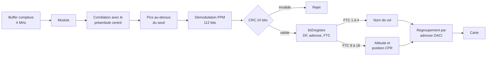
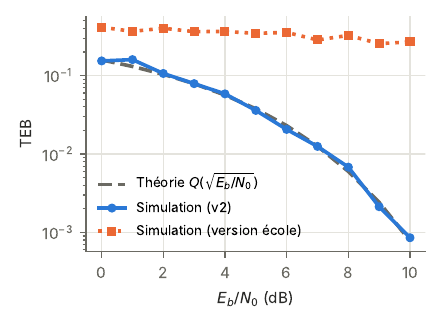
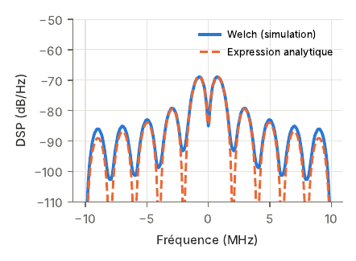
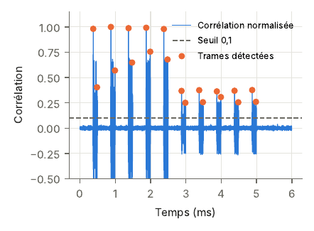
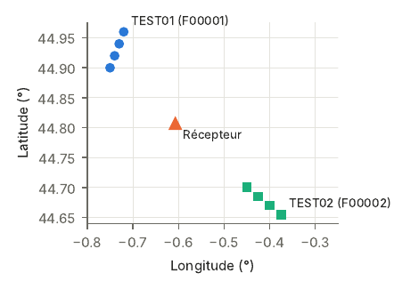

# Récepteur ADS-B 1090 MHz sous MATLAB

Chaîne complète de réception ADS-B (modulation PPM, synchronisation, CRC 24 bits, décodage des trames et des positions CPR), de la simulation au décodage d'enregistrements radio réels affichés sur une carte.

## Contexte

- **Cadre** : projet TS229, ENSEIRB-MATMECA (Bordeaux INP), filière télécommunications. Sujet et encadrement : Guillaume Ferré, Romain Tajan, Alexandre Valade (IMS Bordeaux).
- **Période** : septembre à octobre 2025.
- **Volume** : environ 33 h de séances encadrées prévues par le sujet pour les 12 tâches ; tâches réalisées ici : 1, 2, 3, 4, 6 et 8.
- **Équipe** : binôme avec Thomas Ferreira.
- **Ma contribution** : modulation et démodulation PPM, simulation du TEB, périodogramme de Welch, synchronisation par corrélation, fonction `bit2registre` et décodage des trames, détection des trames dans les signaux réels. Thomas Ferreira a notamment écrit les sous-tâches 2.6 et 4.7 et participé à la tâche 8.
- **Aide d'un assistant IA** : mise en forme de figures (tâches 2 et 6), regroupement des trames par adresse OACI et carte multi-avions (tâche 8), puis la révision v2 décrite plus bas.
- **Fourni par l'école** : sujet, enregistrements (`adsb_msgs.mat`, `buffers.mat`), fond de carte (`affiche_carte.m`, `fond.png`). Ces fichiers ne sont pas redistribués.

La version rendue à l'école est conservée telle quelle dans [`original/`](original/). Le reste du dépôt est la version v2, révisée après le projet (voir [CHANGELOG](CHANGELOG.md)). Rapport de synthèse : [docs/rapport_technique.pdf](docs/rapport_technique.pdf).

## Principe technique

**ADS-B.** Chaque avion estime sa position par GPS et la diffuse environ une fois par seconde sur 1090 MHz, avec son altitude, son identifiant de vol et son adresse OACI. Le récepteur est purement passif : une antenne et un traitement numérique suffisent, d'où un coût bien inférieur à celui d'un radar.

**Modulation PPM.** Un bit dure Ts = 1 µs. Un 1 est une impulsion sur la première moitié du symbole, un 0 une impulsion sur la seconde. En simulation, le signal est échantillonné à 20 MHz (20 échantillons par bit). Le récepteur optimal en bruit blanc gaussien est un filtre adapté échantillonné à chaque demi-symbole : on compare l'énergie des deux moitiés. Le taux d'erreur binaire théorique est alors Pb = Q(√(Eb/N0)).

**Spectre.** Le signal s'écrit 0,5 + Σ Ak p(t − kTs) avec une forme d'onde biphase p(t) et Ak = ±1. Sa DSP est un Dirac en 0 plus Ts sin⁴(πfTs/2) / (πfTs)², ce que l'on vérifie avec un périodogramme de Welch écrit à la main.

**Trame.** Une trame dure 120 µs : un préambule de 8 µs (4 impulsions à 0, 1, 3,5 et 4,5 µs), puis 112 bits. Ces bits se décomposent en format DF (5 bits), capacité (3), adresse OACI (24), données (56) et contrôle de parité CRC (24).

**Synchronisation.** Le préambule ne peut pas être produit par une suite de bits PPM. Le maximum de sa corrélation normalisée avec le signal reçu donne donc le début de la trame. Cette métrique ne dépend pas de l'atténuation, et la décision sur le module rend le récepteur insensible à la phase. L'effet Doppler (environ 900 Hz pour un avion à 900 km/h) fait tourner la phase de moins d'un radian sur une trame de 120 µs, et la décision sur le module y est insensible.

**CRC.** Un code cyclique de degré 24 détecte les trames corrompues : l'émetteur ajoute le reste de la division modulo 2 du message par le polynôme générateur, et le récepteur ne décode que les trames dont le reste est nul.

**CPR.** La latitude et la longitude sont codées sur 17 bits chacune par le Compact Position Reporting. Ce codage découpe le globe en zones (60 en latitude pour une trame paire, 59 pour une impaire) et ne transmet que la position dans la zone. Avec une position de référence à moins de 180 milles nautiques (ici le récepteur), on retrouve la zone puis la position absolue.

## Architecture



| Dossier | Contenu |
|---|---|
| `src/phy` | `modulation_ppm`, `preambule_adsb`, `estimer_retard`, `demodulation_ppm`, `Mon_Welch` |
| `src/mac` | `bit2registre`, `crc_reste`, `crc_valide`, `bits2entier`, `cpr2LatLon`, `cprNL`, `cprMod` |
| `src/app` | `process_buffer`, `mettre_a_jour_avions`, `resumer_avions`, `tracer_avions` |
| `scripts` | un script par tâche du sujet (1, 2, 3, 4, 6, 8) |
| `tests` | `run_tests` : tests sans données de l'école |

## Résultats

Les figures ci-dessous viennent de la vérification de la v2, faite avec une réplique NumPy des mêmes fonctions. Les scripts MATLAB produisent les figures équivalentes.

| Tâche | Résultat |
|---|---|
| 1 | TEB simulé de 0 à 10 dB, superposé à la courbe théorique  |
| 2 | DSP estimée par Welch (1562 FFT de 256 points) superposée à l'expression analytique  |
| 3 | Trame intègre reconnue, un bit inversé détecté |
| 4 | Retard estimé exactement sans bruit, malgré un décalage Doppler jusqu'à 1 kHz et une phase aléatoire  |
| 6 | `adsb_msgs.mat` : 27 trames sur 27 valides, avion 3420CA identifié IBE3405, 25 positions décodées |
| 8 | `buffers.mat` (9 buffers de 0,5 s, 2 millions d'échantillons chacun) : noms, altitudes et positions de plusieurs avions décodés et affichés sur la carte |

`run_tests` vérifie aussi la chaîne sans les données de l'école. Il utilise des trames publiques de référence (identification KLM1023, altitude 38 000 ft et position 52,2572° N, 3,9194° E) et un buffer synthétique de deux avions fictifs, dont un quatre fois plus faible : les 10 trames sont retrouvées.



## Installation et utilisation

Prérequis : MATLAB R2020a ou plus récent et Signal Processing Toolbox (`findpeaks`). Aucune autre boîte à outils : le CRC et la conversion binaire sont écrits dans le dépôt.

```matlab
setup        % chemins et vérification des boîtes à outils
run_tests    % tests, sans données
demo         % tests, simulations des tâches 1 à 4, puis tâches 6 et 8 si les données sont présentes
```

Pour les tâches 6 et 8, placer `adsb_msgs.mat` et `buffers.mat` dans `data/`. Pour le fond de carte, placer `affiche_carte.m` et `fond.png` dans `ecole/`. Chaque script peut aussi être lancé seul, par exemple `tache8_buffers`.

## Limites et pistes d'amélioration

- Décodage CPR local uniquement : il suppose l'avion à moins de 180 milles nautiques du récepteur. Le décodage global à partir d'une paire de trames paire et impaire (tâche 7 du sujet) lèverait cette hypothèse.
- Positions au sol (FTC 5 à 8) et vitesses (FTC 19) non décodées.
- Les trames ne sont pas filtrées sur DF = 17 : une trame valide d'un autre format qui porterait le même champ de données serait décodée.
- Seuil de détection fixé à 0,1 du maximum du buffer : un avion très faible à côté d'un avion très fort peut être manqué.
- Synchronisation fréquentielle (tâche 5), temps réel avec radio logicielle (tâche 9), ancienneté, distance et vue 3D (tâches 10 à 12) non réalisés.

## Améliorations personnelles (v2)

Révision faite après le projet ; le détail est dans le [CHANGELOG](CHANGELOG.md).

- `cpr2LatLon`, `cprNL` et `cprMod` écrits d'après l'annexe C du sujet, alors que la version école appelait les corrigés compilés fournis.
- Tâche 1 : instants d'échantillonnage du filtre adapté corrigés, boucle jusqu'à 100 erreurs, courbe théorique superposée.
- Tâche 2 : signal PPM conforme au sujet (amplitude corrigée) et DSP analytique superposée.
- Tâche 4 : vrai préambule ADS-B et signal PPM.
- CRC écrit à la main (division modulo 2), car `crc.detector`, utilisé à l'école, a été retiré de MATLAB en R2023b.
- Code découpé en fonctions courtes, position de référence passée en argument, tests et script de démonstration.

## Références

- Sujet du projet TS229, ENSEIRB-MATMECA, 2024/2025.
- J. Sun, *The 1090 Megahertz Riddle: A Guide to Decoding Mode S and ADS-B Signals*, 2e éd., TU Delft OPEN Publishing, 2021 (trames de référence des tests).
